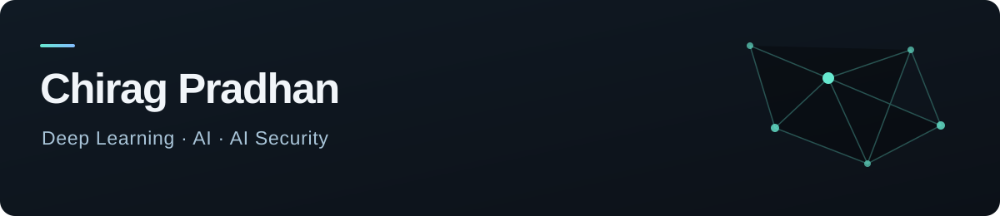

### Technical interests

- **AI security** — prompt injection defenses, agent guardrails, and safe tool use.
- **Deep learning** — computer vision, generative models, and multimodal learning.

### Tech stack

- **Languages** — Python, C++, JavaScript
- **ML & deep learning** — PyTorch, TensorFlow, scikit-learn, OpenCV
- **AI applications** — FastAPI, Flask, Streamlit, Gradio
- **Tools & platforms** — Hugging Face, AWS, Git

### Selected projects

- **[Diffusion-based image editing](https://github.com/qipchip31/hair_root_touch_up)** — SDXL and MediaPipe for hair root touch-ups.
- **[Multimodal fruit quality assessment](https://github.com/qipchip31/Rotten_Fruit_Detection)** — MobileNet vision models combined with microwave sensing.

Research in **[CNN–LSTM channel estimation](https://qipchip.com/research/hybrid-cnn-lstm-channel-estimation)** for 5G Massive MIMO.

---

[Website](https://qipchip.com) · [LinkedIn](https://www.linkedin.com/in/qipchip)
